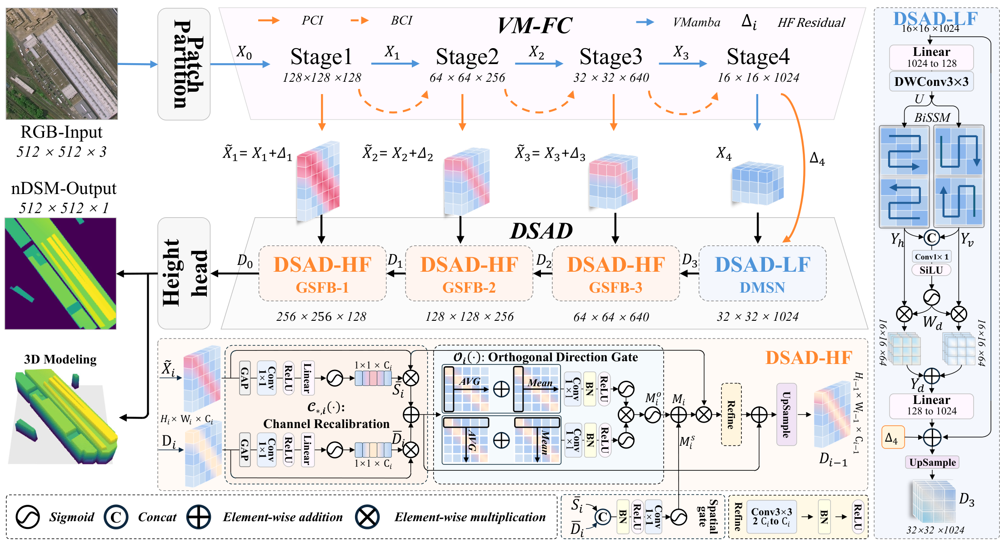
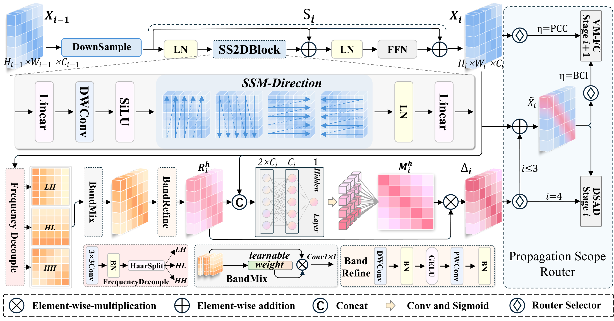
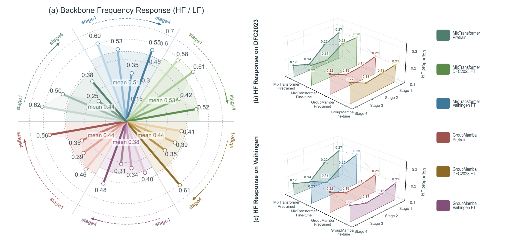
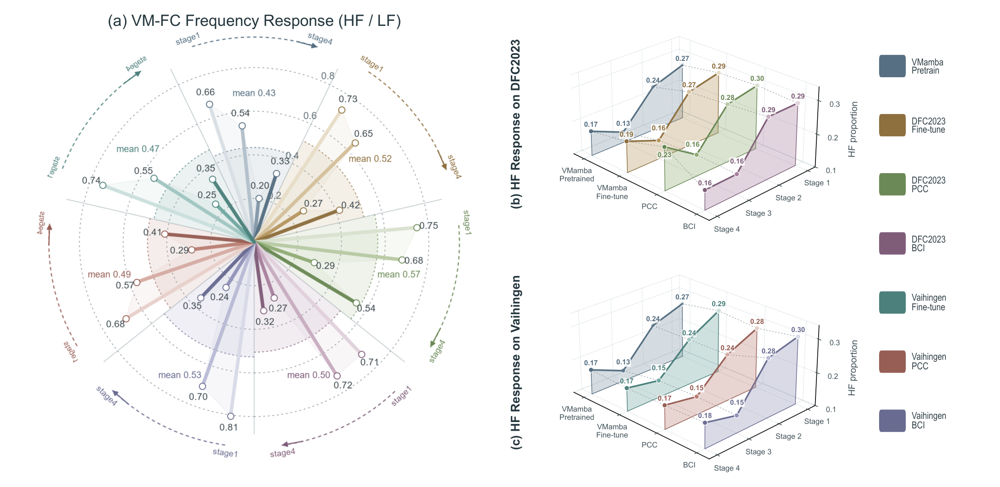
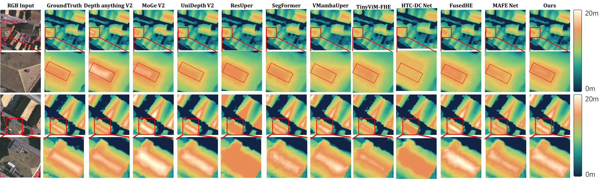
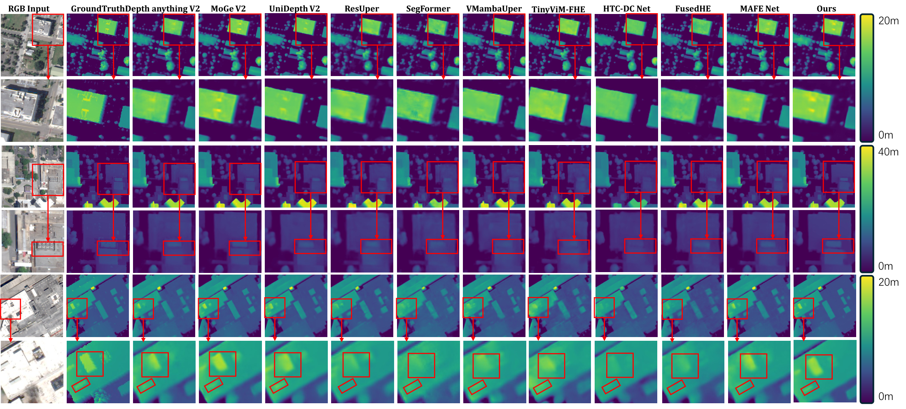
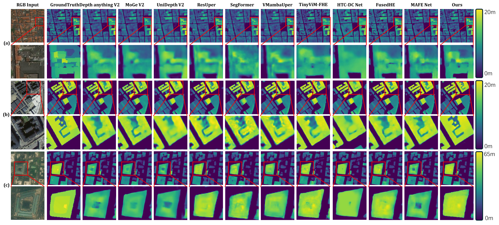

# FCHMamba

### 面向遥感单幅高程估计的频率互补融合与先验兼容传播

[English](README.md) · [GitHub](https://github.com/BPXwithNQP/FCHMamba)

**农启霈**<sup>1,†</sup>、**李政蓬**<sup>1,2,†</sup>、**高政**<sup>3</sup>、**管伟春**<sup>1</sup>、**李姝娴**<sup>1</sup>、**张一凡**<sup>1</sup>、**张媛媛**<sup>1,*</sup>、**胡军**<sup>2,**</sup>

<sup>1</sup> 辽宁科技大学计算机与软件工程学院，中国辽宁鞍山，114051  
<sup>2</sup> 辽宁科技大学电子与信息工程学院，中国辽宁鞍山，114051  
<sup>3</sup> School of Computer Science and Engineering, University of New South Wales, Sydney, NSW 2052, Australia

<sup>†</sup> 共同第一作者。<sup>*</sup> 通讯作者。<sup>**</sup> 共同通讯作者。

张媛媛 ORCID：[0009-0003-7773-1856](https://orcid.org/0009-0003-7773-1856)。

## 项目简介

FCHMamba 从单张 RGB 遥感影像预测稠密米制高程图，在单一 VMamba 主干内融合预训练结构表征与局部高频信息。

本方法同时关注两个问题：**哪些局部信息应补充预训练特征，以及这些补偿应传播多远？**

## 数据集获取

请通过各数据集的官方页面获取数据，并遵循提供方的使用条款。本仓库不重新分发原始数据。

| 数据集 | 官方页面 |
| --- | --- |
| Vaihingen | [ISPRS Vaihingen 数据集](https://www.isprs.org/resources/datasets/benchmarks/UrbanSemLab/2d-sem-label-vaihingen.aspx) |
| DFC2019 Track 1 | [IEEE GRSS 2019 Data Fusion Contest](https://www.grss-ieee.org/community/technical-committees/2019-ieee-grss-data-fusion-contest/) |
| DFC2023 Track 2 | [IEEE GRSS 2023 Data Fusion Contest](https://www.grss-ieee.org/community/technical-committees/2023-ieee-grss-data-fusion-contest/) |

## 代码与模型权重

仓库包含 FCHMamba 的模型装配、配置文件、数据与评估工具，以及训练和测试入口。

- `models/model.py`：FCHMamba 模型装配与预测头。
- `models/Blocks/GSFB.py`：门控多尺度跳跃融合。
- `configs/` 与 `models/Blocks/block.yaml`：主干和模块配置。
- `train_config/`：Vaihingen、DFC2019 和 DFC2023 的训练配置。
- `train.py`、`test.py`、`utils/` 与 `nqp_utils/`：训练、评估、指标及模型统计工具。

FCHMamba 训练权重可从[百度网盘](https://pan.baidu.com/s/1Ba6Yo-GnbK30OgYpWCxZtg?pwd=2026)下载，提取码：`2026`。

### 环境配置

代码基于 Python 3.10 与支持 CUDA 的 PyTorch 开发。请根据本机 CUDA 环境安装依赖：

```bash
pip install -r requirements_rest.txt
pip install -r requirements_mambavision.txt
```

状态空间主干需要对应的 selective-scan CUDA 实现。运行前请修改 `train_config/*.yaml` 中的数据集路径。

### 训练与测试

```bash
# 示例：在 DFC2023 上训练
python main.py --config train_config/dfc2023.yaml --dataset_root /path/to/datasets

# 使用下载的权重进行测试
python test.py --config train_config/dfc2023.yaml \
  --ckpt_path /path/to/FCHMamba.ckpt \
  --test_dir /path/to/test/data
```

## 模型对比：三个数据集的 RMSE

下表摘自论文主对比表，仅展示 RMSE（单位：m，越低越好）。FCHMamba 使用默认 PCC 路径，最优值加粗。

| 方法 | Vaihingen | DFC2019 | DFC2023 |
| --- | ---: | ---: | ---: |
| MAFENet | 1.418 | 1.538 | 4.578 |
| Elevation-CVMamba* | 1.496 | 2.250 | — |
| RAEPHR-Net* | 1.448 | 1.950 | — |
| FusedHE | 1.366 | 1.660 | 3.304 |
| HTC-DC-Net | 1.343 | 2.228 | 4.059 |
| Im2Height | 2.430 | 3.757 | 6.470 |
| SegFormer | 1.631 | 1.853 | 3.790 |
| VMUPerNet | 1.525 | 1.683 | 4.155 |
| ResNet-UPerNet | 1.804 | 1.838 | 4.225 |
| TinyViM-FHE | 1.453 | 1.611 | 3.452 |
| Depth Anything V3 | 1.629 | 1.783 | 5.502 |
| UniDepth V2 | 1.289 | 1.799 | 4.809 |
| MoGe-2 | 1.331 | 1.494 | 4.638 |
| Depth Anything V2 | 1.371 | 1.614 | 4.661 |
| **FCHMamba (Ours)** | **1.258** | **1.457** | **2.853** |

\* 结果引用原论文；其余结果为本文复现。— 表示当前论文未报告该项结果。

FCHMamba 在三个基准上均取得所评估方法中最低的 RMSE，相对各数据集最优对比基线分别降低 **2.4%**、**2.5%** 和 **13.7%**。

模型包含 **108.21 M 参数**，在论文所用输入配置下计算量为 **286.20 GFLOPs**，兼顾预测精度与计算开销。

## 主模型框架

- **频域补偿编码器 VM-FC：** 通过方向性频率分解、跨频带混合和学习型门控构造多尺度高频补偿。
- **双流自适应解码器 DSAD：** 通过方向性长程建模与门控跳跃融合，在渐进高程恢复中结合区域上下文和局部结构线索。
- **先验兼容补偿 PCC：** 默认路径保留原生跨阶段编码路径，并向解码器提供补偿。主干耦合注入 BCI 作为匹配对照，将补偿进一步传入后续编码阶段。

[](assets/architecture.pdf)

[查看原始框架 PDF](assets/architecture.pdf)

VM-FC 在单一主干内构造多尺度补偿，DSAD 联合原生深层上下文与补偿跳跃特征，逐级恢复高程图。原图中的旧标记“PCI”对应本文统一使用的 PCC；图像沿用现有 PDF，未重绘。

## 频率补偿与传播路径

[](assets/vmfc.pdf)

[查看原始 VM-FC PDF](assets/vmfc.pdf)

两条路径使用相同的补偿构造与补偿跳跃特征，仅 BCI 将补偿写入后续编码状态。在最深阶段，补偿于 DMSN 上下文建模之后、解码上采样之前加入。

## 频谱分析

### 预训练与任务适配

预训练主干呈现低频占优，微调后的频率重组随主干和数据集而变化。例如，VMamba 的平均 HF/LF 从预训练时约 0.434，变为 Vaihingen 微调后的约 0.470 和 DFC2023 微调后的约 0.515。

[](assets/backbone-spectrum.pdf)

[查看原始频谱 PDF](assets/backbone-spectrum.pdf)

### 补偿路径的层级差异

PCC 的高频增强更集中于深层，BCI 则将高频变化引入前中层并沿后续状态传播。两条路径不仅改变高频响应强度，也改变其层级分布；更强的高频响应并不必然对应更低预测误差。

[](assets/route-spectrum.pdf)

[查看原始路径频谱 PDF](assets/route-spectrum.pdf)

### 频带阈值稳健性

下表摘录论文阈值实验中的平均 HF/LF。low 和 high 为归一化径向频率边界。不同阈值改变绝对数值，但三种配置的相对变化趋势保持一致，说明主要频谱结论对所测试阈值划分的敏感度较低。

| low / high | 预训练 VMamba | 微调 VMamba | VM-FC |
| --- | ---: | ---: | ---: |
| 0.20 / 0.45 | 0.5889 | 0.7111 | 0.7833 |
| 0.30 / 0.55 | 0.2956 | 0.3510 | 0.3838 |
| 0.35 / 0.60 | 0.2079 | 0.2438 | 0.2675 |

HF/LF 是频率响应统计量，不是预测精度指标。上述统计使用固定的 500 张 ImageNet 验证图像作为探针。

## 预测可视化

以下图片沿用论文中的对比结果，**Ours** 表示 FCHMamba。点击图片可查看完整分辨率。

### Vaihingen



### DFC2019



### DFC2023



## 发布状态

- **源代码：** 已在本仓库提供。
- **模型权重：** [百度网盘](https://pan.baidu.com/s/1Ba6Yo-GnbK30OgYpWCxZtg?pwd=2026)，提取码 `2026`。
- **论文与引用：** 发表信息和引用条目将在可用时补充。

本仓库不重新分发基准数据集，数据获取与使用遵循相应提供方的条款。

## Funding

本研究得到国家自然科学基金（项目编号：62376036、52574151）、中国科协青年科技人才培育工程博士生专项，以及辽宁省教育厅高等学校基础科研项目（项目编号：LJ222410146057、LJ212410146040、LJ212410146006）的支持。

## 致谢

感谢 DGPF 提供 Vaihingen 数据，以及 IEEE GRSS 2019 和 2023 Data Fusion Contest 的数据提供方与组织方。

## 许可证

仓库中包含基于 FusedHE 与 SegFormer 的组件，其科研用途条款和署名要求见 [LICENSE](LICENSE)。

## 联系方式

科研交流请联系张媛媛（[yuanyuan@ustl.edu.cn](mailto:yuanyuan@ustl.edu.cn)）或胡军（[320083700074@ustl.edu.cn](mailto:320083700074@ustl.edu.cn)）。
